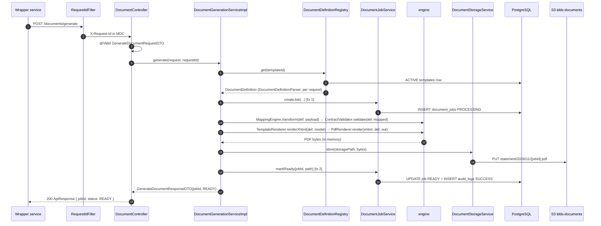

# TDDS Stage 1 (MVP) — Low-Level Design

**Status:** Draft · **Date:** Nov 3, 2026 · **Author:** Siddhesh Datkhile

**Based on:** TDDS Build Plan (Stage 1\) · TDDS Stage 1 DB Design · TDDS POC §3.3, §3.4, §5, §8 · `tdds-config/statement/v1`

**Revised Nov 9, 2026:**

- **Engine (§4, §5):** uses the five POC §3.4 interfaces (`DocumentDefinitionRegistry`, `MappingEngine`, `ContractValidator`, `TemplateRenderer`, `PdfRenderer`), each with one simple implementation, and every method takes the whole `DocumentDefinition`. Changes from the POC:  
  - `ContractValidator.validate` returns the typed model (validation and conversion in one pass)  
  - lookup is by `templateId` only  
- **Services:** `TemplateService` and `DocumentRenderService` removed; their jobs are done by `DbDocumentDefinitionRegistry` and the renderers.  
- **Identity:** document type removed; templates are identified by `templateId` \+ `version`, and the request field is now `templateId`.  
- **Config files:** SHA-256 columns and checks removed. `minItems` removed from contracts. `inputFormats` renamed `dateFormats`. Details in `TDDS-Engine-Definition-Model.md`.

## 1\. Scope

Stage 1 is **sync**: one `POST /documents/generate` call carries everything; TDDS maps, validates, renders, stores the PDF in S3 and replies with the `jobId` and status `READY`. **The PDF is not returned in the response.**

- **In:** generate API, engine (definition registry and parser, mapping engine, contract validator, template and PDF renderers), S3 copy, job \+ audit rows, statement onboarded by Flyway seed.  
- **Out:** async (`202` / status), the download API, publish / activate APIs, config caching, `compute` mapping form (in review), PDF password / signing, retention purge. (SHA-256 config checks were dropped from the design after review.)  
- **No security in Stage 1:** no API keys, no caller or channel verification. Access is restricted at the network level only (internal callers). `client_id` columns stay `null` until security is added.  
- **One payload only.** The wrapper service sends all data in the request body. TDDS makes no outbound calls and reads no separate request parameters.  
- **No customer data at rest.** Not in the DB, not in logs, not on local disk. Only the PDF in S3.  
- **One project, no modules yet.** Stage 1 is a single Spring Boot project with the standard layered packages. The Build Plan's split (`tdds-core` library; `collector` / `config` / `generator` modules) comes later. Until then, the engine lives in its own `engine` package with no Spring or DB code, so it can be moved out as-is (§4).

## 2\. Request flow



&nbsp;

**On any failure after the job row exists:** `markFailed(jobId, errorCode)` \[tx 3\] sets `FAILED` \+ `error_code` and inserts audit `GENERATE / FAILURE`, then the exception goes on to `GlobalExceptionHandler`.

**Before the job row exists** (invalid request, unknown template id, broken template config) there is no job: `template_version_id` is `NOT NULL`, so there is nothing to link it to. These are logged only (request id, template id, error code).

### 2.1 Steps and owners

| \# | Step | Class | Package | Error code |
| :---- | :---- | :---- | :---- | :---- |
| 1 | Read or create request id, put in MDC, echo in response | `RequestIdFilter` | `filter` |  |
| 2 | Size limit, JSON parse, bean validation | `DocumentController` \+ `@Valid` | `controller` | `INVALID_REQUEST` |
| 3 | Load active version; read and check contract \+ mapping | `DbDocumentDefinitionRegistry` → `DocumentDefinitionParser` | `service.impl`, `engine` | `CONFIG_NOT_FOUND`, `MAPPING_ERROR` (broken config) |
| 4 | Create job `PROCESSING`, version fixed | `DocumentJobServiceImpl.createJob` | `service.impl` |  |
| 5 | Transform payload → contract fields (raw values) | `MappingEngine` | `engine` |  |
| 6 | Validate and convert in one pass: required, type, enum, dates, numbers → `LocalDate` / `LocalDateTime` / `BigDecimal` | `ContractValidator` | `engine` | `DATA_CONTRACT_VIOLATION` |
| 7 | Thymeleaf → XHTML, then OpenHTMLtoPDF → bytes | `TemplateRenderer`, `PdfRenderer` | `engine` | `RENDER_ERROR` |
| 8 | PUT PDF to S3 | `S3DocumentStorageServiceImpl` | `service.impl` | `STORAGE_ERROR` |
| 9 | Job `READY` \+ audit `SUCCESS` | `DocumentJobServiceImpl.markReady` | `service.impl` |  |
| 10 | Return `jobId` \+ `READY` | `DocumentController` | `controller` |  |

### 2.2 Transactions

- **No transaction around the whole call.** Rendering a 5,000-row statement takes seconds; holding a DB connection for that would drain the pool.  
- Three short transactions in `DocumentJobServiceImpl` (a separate bean, so the `@Transactional` proxy applies; a self-call inside `DocumentGenerationServiceImpl` would skip it):  
  - `createJob`: insert job.  
  - `markReady`: update job \+ insert audit, one transaction.  
  - `markFailed`: update job \+ insert audit, one transaction.  
- If `markReady` fails after the PDF is in S3, the job stays `PROCESSING` and an orphan object is left. Accepted for Stage 1; Stage 4's purge job removes objects with no `READY` job.

## 3\. API

### 3.1 `POST /documents/generate`

**Headers**

| Header | Required | Notes |
| :---- | :---- | :---- |
| `Content-Type` | yes | `application/json` |
| `X-Request-Id` | no | Consumer's id; TDDS creates a UUID if missing. Max 64 chars, `[A-Za-z0-9._-]`. Opaque, never an account number |

**Body**

```json
{
  "templateId": "statement",
  "channel": "MOBILE",
  "payload": {
    "StatementPeriod": { "FromDate": "20200101", "ToDate": "20240601" },
    "CustomerDetails": { "CustomerId": "100000001", "CustomerName": "…", "AddressDetails": [ … ] },
    "AccountDetails":  { "AccountId": "50160007314712", "AccountType": "Savings Account", … },
    "AccountStatement": [ { "TransactionDate": "20240410", "Desc": "…", … } ]
  }
}
```

&nbsp;

| Field | Type | Rules |
| :---- | :---- | :---- |
| `templateId` | string | `@NotBlank`, alphanumeric, max 64 (`templates.template_id` is `VARCHAR(64)`). The ID assigned by the bank service; matches `templates.template_id` |
| `channel` | enum | Optional. `MOBILE`, `NET_BANKING`, `WHATSAPP`, `API`. Recorded on the job and audit row for reporting; **not verified** against the caller in Stage 1 |
| `payload` | JSON object | `@NotNull`, must be an object. **Not validated by the controller**: its shape is template-specific and checked by the mapping \+ contract (steps 5–6) |

- The envelope is fixed for every template; only `payload` differs. The payload sample per template lives in `tdds-config/{templateId}/v{n}/samples/payload-complete.json`.  
- **Size limit:** `tdds.request.max-body-size` (default 10 MB, enough for \~20,000 rows). Over the limit → `413`.

**`200 OK`** (standard `ApiResponse<T>` wrapper; `X-Request-Id` echoed as a header)

```json
{
  "status": 200,
  "message": "Document generated",
  "data": {
    "jobId": "9f1c2e7a-4b1d-4c55-9a0e-2f6b8d31c0aa",
    "status": "READY"
  }
}
```

- `READY` means the PDF is stored in S3 at `{templateId}/{yyyy}/{MM}/{jobId}.pdf`. The response carries no PDF, no storage path and no customer data.  
- A failed job does not return `200`: it returns the error shape (§3.2) with `jobId` and the error code; the job row is `FAILED`.

### 3.2 Errors

```json
{
  "status": 422,
  "message": "Payload does not match the data contract",
  "errorCode": "DATA_CONTRACT_VIOLATION",
  "requestId": "c0a8…",
  "jobId": "9f1c2e7a-…",
  "violations": [
    { "field": "customerName", "rule": "REQUIRED" },
    { "field": "transactions[3].amount", "rule": "NOT_A_NUMBER" }
  ]
}
```

- `violations` name the **contract field and the rule only, never the value** (the value may be an account number or a name).  
- `jobId` only when the job row exists.

| Error code | HTTP | When | Job row |
| :---- | :---- | :---- | :---- |
| `INVALID_REQUEST` | 400 | Bad JSON, missing `templateId` / `payload`, unknown `channel` value, bad `X-Request-Id` | no |
| (payload too large) | 413 | Body over `tdds.request.max-body-size` | no |
| `CONFIG_NOT_FOUND` | 404 | No `ACTIVE` `templates` row for `templateId` (unknown or disabled) | no |
| `DATA_CONTRACT_VIOLATION` | 422 | Missing required field, wrong type, bad enum, unparseable date / number | `FAILED` |
| `MAPPING_ERROR` | 500 | Template config is invalid: unknown key, bad path syntax, unknown `system.` function, mapping and contract fields don't match, missing `dateFormats`. Found when the definition is loaded, before the job row. A config bug, not a payload bug | no |
| `RENDER_ERROR` | 500 | Thymeleaf or OpenHTMLtoPDF failure | `FAILED` |
| `STORAGE_ERROR` | 503 | S3 PUT failed | `FAILED` |
| `INTERNAL_ERROR` | 500 | Anything else | `FAILED` if it exists |

## 4\. Package layout

One Gradle project (the existing app). Standard layered packages; `<base>` \= `com.joshsoftware.templateDrivenDocumentService`.

```
<base>/
├── TemplateDrivenDocumentServiceApplication
├── config/            ClockConfig, EngineConfig (engine beans), SecurityConfig, S3Config, TddsProperties
├── controller/        DocumentController
├── service/           DocumentGenerationService, DocumentJobService, DocumentStorageService
│   └── impl/          DocumentGenerationServiceImpl, DocumentJobServiceImpl, S3DocumentStorageServiceImpl,
│                      DbDocumentDefinitionRegistry (implements engine DocumentDefinitionRegistry)
├── repository/        TemplateRepository, DocumentJobRepository, AuditLogRepository
├── entity/            Template, DocumentJob, AuditLog
├── enums/             TemplateStatus, JobStatus, AuditAction, AuditOutcome, Channel, ErrorCode
├── dto/
│   ├── request/       GenerateDocumentRequestDTO
│   ├── ApiResponse, ErrorResponse, ViolationDTO
│   └── response/      GenerateDocumentResponseDTO (jobId, status)
├── exception/         AppException, InvalidRequestException, ConfigNotFoundException,
│   │                  StorageException
│   └── handler/       GlobalExceptionHandler
├── filter/            RequestIdFilter
├── constants/         HeaderConstants
└── engine/            ← no Spring, no JPA, no logging; moves to tdds-core later
    ├── definition/    DocumentDefinition, ContractField, FieldType, DateFormats,
    │                  DocumentDefinitionRegistry «interface», DocumentDefinitionParser
    ├── mapping/       MappingEngine «interface», DefaultMappingEngine
    ├── contract/      ContractValidator «interface», DefaultContractValidator, ViolationRule, Violation
    ├── render/        TemplateRenderer «interface», ThymeleafTemplateRenderer,
    │                  PdfRenderer «interface», OpenHtmlPdfRenderer, DataUriOnlyResolver
    └── exception/     EngineException, InvalidDefinitionException, DataContractViolationException,
                       MappingException, RenderException
```

**Keep it easy to split later** (Build Plan §3 modules):

- `engine` imports nothing from the rest of the app and no Spring / JPA / logging. Its implementations and `DocumentDefinitionParser` are created as beans in `EngineConfig`, not annotated with `@Component`. One ArchUnit test checks this.  
- The app depends only on the 5 engine interfaces (POC §3.4), which are the future `tdds-core` API. `DocumentDefinitionRegistry` is implemented in the app (`DbDocumentDefinitionRegistry`) because it reads the DB; `template-generator` can implement it over files.  
- `DocumentJob` holds `templateVersionId` as a `UUID` field, not `@ManyToOne`. When `config` becomes its own module, a JPA relation would reach into its tables.  
- Services already follow the future module lines (the "Later module" column in §6.2). Splitting later is moving classes, not rewriting them.

## 5\. Engine (`engine` package)

Plain Java, no Spring, no DB, no logging. Later moved to `tdds-core` and shared with `template-generator check`, so both behave the same. Every class is explained, with examples, in `TDDS-Engine-Definition-Model.md`.

**Design:** the five interfaces from POC §3.4, one simple implementation each. Every method takes the whole `DocumentDefinition`. Inside an implementation the code is plain private methods: no rule classes, no type registries. The mapping is kept as JSON and interpreted directly, and its config is checked without a payload before a version is saved.

### 5.1 Types and interfaces

```java
public record DocumentDefinition(
    UUID templateVersionId,                 // templates.id
    String templateId, int version,         // e.g. "statement", 1
    String templateHtml,                    // bundled XHTML
    Map<String, ContractField> contract,    // contract.json "fields", file order
    DateFormats dateFormats,                // mapping.json "dateFormats"
    JsonNode transform) {}                  // mapping.json "transform", read-only copy

public record ContractField(FieldType type, boolean required,
    Map<String, ContractField> fields,      // OBJECT
    ContractField items,                    // ARRAY
    List<String> values) {}                 // ENUM
public enum FieldType { STRING, NUMBER, DATE, DATETIME, ENUM, ARRAY, OBJECT }
public record DateFormats(String datePattern, String datetimePattern,
    DateTimeFormatter date, DateTimeFormatter datetime) {}   // strict; either pattern optional

// from DB (S3 later); parsed once per version and cached
public interface DocumentDefinitionRegistry {
    DocumentDefinition get(String templateId);
}
// payload comes in the request; JSON in memory only
public interface MappingEngine {
    JsonNode transform(DocumentDefinition def, JsonNode payload);
}
// validates and converts in one pass; throws DataContractViolationException with every violation
public interface ContractValidator {
    Map<String, Object> validate(DocumentDefinition def, JsonNode mapped);
}
public interface TemplateRenderer {
    String renderXhtml(DocumentDefinition def, Map<String, Object> model);
}
public interface PdfRenderer {
    void render(String xhtml, DocumentDefinition def, OutputStream out);
}
```

&nbsp;

| Interface | Implementation | Where |
| :---- | :---- | :---- |
| `DocumentDefinitionRegistry` | `DbDocumentDefinitionRegistry` (uses `DocumentDefinitionParser`) | app `service.impl` (reads the DB) |
| `MappingEngine` | `DefaultMappingEngine` | engine |
| `ContractValidator` | `DefaultContractValidator` | engine |
| `TemplateRenderer` | `ThymeleafTemplateRenderer` | engine |
| `PdfRenderer` | `OpenHtmlPdfRenderer` | engine |

**Differences from POC §3.4:**

| POC §3.4 | Here | Why |
| :---- | :---- | :---- |
| `get(bank, docType)` | `get(templateId)` | no document type; templates are identified by `templateId` \+ `version` |
| "checksum-checked" | no checksums | dropped after the DB review |
| `transform(def, payload, req)` | `transform(def, payload)` | the mapping needs only the payload and the clock |
| `void validate(...)` | `Map<String, Object> validate(...)` returns the typed model | validation and conversion in one pass, so they can't disagree |

### 5.2 Definition registry and parser

- **`DbDocumentDefinitionRegistry.get(templateId)`:**  
  1. Finds the `ACTIVE` row; if there's none, throws `ConfigNotFoundException`.  
  2. Calls `DocumentDefinitionParser.parse(id, templateId, version, templateHtml, contractJson, mappingJson)`.  
  3. Caches by `templateVersionId` (versions are immutable), so each version is parsed once per instance.  
- **`DocumentDefinitionParser`** is a concrete engine class with no interface:  
  - **Contract:** reads `contract_json` into `ContractField`s (`type`, `required`, `fields`, `items`, `values`). A missing `required` means optional. There's no `minItems`; an empty array is valid.  
  - **Mapping:** reads `mapping_json`: `dateFormats` (optional; `date` and `datetime`, each used only by `system.*` and the validator) and `transform`.  
  - **Result:** builds the `DocumentDefinition`.  
  - **No config checks yet:** Config file checking (mapping against contract, strict keys, duplicate keys) is deferred; it will run when a version is uploaded, not per request.

### 5.3 Mapping engine

Supports exactly these forms:

| Form | Example | Result |
| :---- | :---- | :---- |
| Path | `"AccountDetails.IFSC"`, `"…AddressDetails[0].AddressLine"` | Value at the path; `null` if any segment is missing |
| System function | `"system.today()"`, `"system.now()"` | From the injected `Clock` (IST), written in `dateFormats` |
| List | `{ "from": "AccountStatement", "map": { … } }` | One object per item; a single object (not array) counts as one item |
| Pick one | `{ "from": "…AddressDetails", "select": { "AddressType": "…" }, "map": { … } }` | First match, else first item; `null` for an empty list. `select: {}` takes the object as is (nested objects) |
| Not supplied | `null` | `null` |

- A broken form (bad path, unknown `system.*`, missing `from`/`map`, bad `select`) fails with `InvalidDefinitionException` → `MAPPING_ERROR` when `transform` reaches it.  
- `transform` treats missing payload data as **not** an error; the validator reports it.  
- Paths are a small dotted-path reader over `JsonNode`, not full JsonPath, so no filter or script expressions can run from config.  
- `Clock` is passed in the constructor. Tests use `Clock.fixed(2024-06-01T10:00:00+05:30)` to match `expected-mapped*.json`.  
- `compute` (in review) is added here later; the interface doesn't change.

### 5.4 Contract validator

One walk over `def.contract()` that validates and converts together, so the two can't disagree:

| Contract type | Raw value | Typed value | Violation rules |
| :---- | :---- | :---- | :---- |
| `string` | any scalar | `String` | `REQUIRED` |
| `number` | text or number | `BigDecimal` (never `double`), scale kept | `REQUIRED`, `NOT_A_NUMBER` |
| `date` | text in `dateFormats.date` | `LocalDate` (strict) | `REQUIRED`, `BAD_DATE` |
| `datetime` | text in `dateFormats.datetime` | `LocalDateTime` (strict) | `REQUIRED`, `BAD_DATETIME` |
| `enum` | text, exact match | `String` | `REQUIRED`, `NOT_ALLOWED` |
| `array` | array | `List<…>` | `REQUIRED`, `WRONG_TYPE`, then each item |
| `object` | object | `Map<String, Object>` | `REQUIRED`, `WRONG_TYPE`, then each field (only if present) |

- `required: false` and missing → `null` in the model (template uses `th:if`, as for `address.country`).  
- **Blank string \= missing.** `""` or whitespace only counts as missing for every scalar type: optional → `null`, required → `REQUIRED`. Banks often send empty columns as `""` (e.g. separate withdrawal / deposit amounts); without this an empty optional amount would fail with `NOT_A_NUMBER`. `"0.00"` is a real value and stays `0.00`.  
- Field paths in violations: `address.city`, `transactions[3].amount`.  
- All violations are collected, then thrown together. The model is unmodifiable and keeps field order.

### 5.5 Renderers

- **`ThymeleafTemplateRenderer`:** standalone `TemplateEngine` with `StringTemplateResolver`, `TemplateMode.HTML` (OGNL, not Spring EL). No template cache in Stage 1: the template string is parsed on every request. Its XHTML output is what the escaping test checks.  
- **`OpenHtmlPdfRenderer`:** the maintained fork `io.github.openhtmltopdf:openhtmltopdf-pdfbox`. Page model from the CSS (`@page`, running header and footer, `-fs-table-paginate`). It receives `def` so per-template PDF options (Stage 3 password and signing) can be added without changing the signature.  
- Both wrap failures in `RenderException`.  
- **`DataUriOnlyResolver`:** URI resolver that allows only `data:` URIs and throws on anything else, so a template can never trigger a network or file read (POC §5).  
- Output to a `ByteArrayOutputStream`. No temp files.

### 5.6 Refactor triggers

The internals stay simple until one of these is hit. Because callers only use the interfaces, each refactor stays inside the engine.

| Trigger | Action |
| :---- | :---- |
| `DefaultMappingEngine` \> \~300 lines or \> 7 mapping forms | One class per mapping form |
| `DefaultContractValidator` switch \> \~10 types | One class per type |
| Mapping \> 10% of request time | Compile paths once (with the Stage 2 cache) |

## 6\. document-service classes

### 6.1 Controller — `DocumentController`

```java
@PostMapping(value = "/documents/generate", consumes = APPLICATION_JSON_VALUE)
public ResponseEntity<ApiResponse<GenerateDocumentResponseDTO>> generateDocument(
        @Valid @RequestBody GenerateDocumentRequestDTO request)
```

- Reads the request id from MDC (set by `RequestIdFilter`), calls `DocumentGenerationService.generate`, returns `ResponseEntity.ok(ApiResponse.success(...))`. No other logic.  
- Entry / exit log: `templateId`, `channel`, `jobId`, status, duration. **Never the payload.**

### 6.2 Services

| Interface | Method | Later module | Does |
| :---- | :---- | :---- | :---- |
| `DocumentGenerationService` | `GenerateDocumentResponseDTO generate(GenerateDocumentRequestDTO req, String requestId)` | collector | Orchestrates §2. Catches failures after job creation, calls `markFailed`, rethrows. Not `@Transactional` |
| `DocumentJobService` | `UUID createJob(DocumentDefinition def, Channel ch, String requestId)` | collector | Insert `PROCESSING`. `@Transactional` |
|  | `void markReady(UUID jobId, String storagePath)` |  | `READY`, `completed_at`, `expires_at = now + tdds.documents.retention`, audit `SUCCESS`. `@Transactional` |
|  | `void markFailed(UUID jobId, ErrorCode code)` |  | `FAILED`, `error_code`, `completed_at`, audit `FAILURE`. `@Transactional` |
| `DocumentDefinitionRegistry` (engine interface) | `DocumentDefinition get(String templateId)` | config | §6.3 (`DbDocumentDefinitionRegistry`) |
| `DocumentStorageService` | `String store(UUID jobId, String templateId, byte[] pdf)` | generator | Builds `{templateId}/{yyyy}/{MM}/{jobId}.pdf`, PUTs with SSE, returns the path |

There is no `TemplateService` or `DocumentRenderService`. The service uses the engine interfaces directly: `DocumentDefinitionRegistry`, `MappingEngine`, `ContractValidator`, `TemplateRenderer` and `PdfRenderer`. That means it can be unit-tested with mocks.

`DocumentGenerationServiceImpl.generate`, in outline:

```java
var def   = definitionRegistry.get(req.templateId());
var jobId = documentJobService.createJob(def, req.channel(), requestId);
MDC.put("jobId", jobId.toString());
try {
    var mapped = mappingEngine.transform(def, req.payload());
    var model  = contractValidator.validate(def, mapped);
    var xhtml  = templateRenderer.renderXhtml(def, model);
    var out    = new ByteArrayOutputStream();
    pdfRenderer.render(xhtml, def, out);
    var path   = documentStorageService.store(jobId, def.templateId(), out.toByteArray());
    documentJobService.markReady(jobId, path);
    return new GenerateDocumentResponseDTO(jobId, JobStatus.READY);
} catch (Exception e) {
    documentJobService.markFailed(jobId, ErrorCode.from(e));
    throw e;
}
```

### 6.3 `DbDocumentDefinitionRegistry`

App implementation of the engine's `DocumentDefinitionRegistry`, in `service.impl`.

1. `templateRepository.findByTemplateIdAndStatus(templateId, ACTIVE)` → else `ConfigNotFoundException`. One query; the partial unique index guarantees at most one row. Activating a new version takes effect on the next request.  
2. `documentDefinitionParser.parse(row.id, row.templateId, row.version, row.templateHtml, row.contractJson, row.mappingJson)` → `DocumentDefinition`. Done once per version, then cached by `templateVersionId`; the config was already validated before insert.

**Config checking:** deferred to upload validation. No startup check.

**Cache:** `templateVersionId` → `DocumentDefinition` in a `ConcurrentHashMap`. Safe because a version's content never changes; activating a new version gives a new id. SHA-256 checks were dropped from the design.

### 6.4 Repositories

| Repository | Methods |
| :---- | :---- |
| `TemplateRepository extends JpaRepository<Template, UUID>` | `Optional<Template> findByTemplateIdAndStatus(String templateId, TemplateStatus status)`. `template_id` is `VARCHAR(64)`, so an unknown `templateId` returns empty (`404`) |
| `DocumentJobRepository extends JpaRepository<DocumentJob, UUID>` | `save`, `findById` |
| `AuditLogRepository extends JpaRepository<AuditLog, UUID>` | `save` only |

## 7\. Entities

All: `@Id UUID` (generated), `TIMESTAMPTZ` ↔ `OffsetDateTime`, enums `@Enumerated(STRING)` \+ `@JdbcType(PostgreSQLEnumJdbcType.class)`, `@Getter @Setter`, no `@Data`.

| Entity | Table | Fields | Notes |
| :---- | :---- | :---- | :---- |
| `Template` | `templates` | `id`, `templateId`, `name`, `version`, `status`, `templateHtml`, `contractJson`, `mappingJson`, `createdBy`, `createdAt`, `activatedAt`, `disabledAt` | `templateId` is a plain `String` (`VARCHAR(64)`), the alphanumeric ID assigned by the bank service. Unique on (`templateId`, `version`); at most one `ACTIVE` version per `templateId`. Content columns `updatable = false` (DB trigger enforces it too). Large `TEXT` columns `@Basic(fetch = LAZY)` not needed: always read together |
| `DocumentJob` | `document_jobs` | `id`, `templateVersionId`, `channel`, `requestId`, `status`, `errorCode`, `storagePath`, `createdAt`, `completedAt`, `expiresAt` | IDs as `UUID`, not relations (§4) |
| `AuditLog` | `audit_logs` | `id`, `documentJobId`, `action`, `outcome`, `clientId`, `channel`, `createdAt` | Insert-only: `@Immutable`. `clientId` is `null` in Stage 1 (no security) |

&nbsp;

| Enum | Values |
| :---- | :---- |
| `TemplateStatus` | `DRAFT`, `ACTIVE`, `DISABLED` |
| `JobStatus` | `PROCESSING`, `READY`, `FAILED`, `EXPIRED` |
| `AuditAction` | `GENERATE`, `DOWNLOAD`, `EXPIRE` (only `GENERATE` used in Stage 1\) |
| `AuditOutcome` | `SUCCESS`, `FAILURE` |
| `Channel` | `MOBILE`, `NET_BANKING`, `WHATSAPP`, `API` |
| `ErrorCode` | §3.2 codes, each with its HTTP status (used only by `GlobalExceptionHandler`) |

## 8\. Cross-cutting

| Concern | Rule |
| :---- | :---- |
| Logging | MDC `requestId`, `jobId`. Log template id, version, row count, byte size, step durations (map, check, render). The engine itself never logs. Never payload, mapped values, model, XHTML, or exception messages from Jackson / Thymeleaf (they can quote input) |
| Parse errors | `HttpMessageNotReadableException` → `INVALID_REQUEST` with a fixed message; the cause is not logged |
| Memory | Payload, model and PDF bytes live only for the request (the PDF is written to S3, not returned). No temp files; OpenHTMLtoPDF writes to memory |
| Time | One `Clock` bean, zone `Asia/Kolkata`; used by mapping (`system.*`) and job timestamps |
| Security (Stage 1\) | None: no API keys, no caller or channel checks. `spring-boot-starter-security` is on the classpath and locks every endpoint by default, so `SecurityConfig` sets a permit-all, stateless chain with CSRF off. Kept (not removed) so API keys can be added later without a build change. Access is limited by the network only |
| S3 | AWS SDK v2 `S3Client`; MinIO locally. Bucket `tdds-documents`, SSE on, no public access |
| Config | `tdds.request.max-body-size`, `tdds.documents.retention` (e.g. `P7D`), `tdds.storage.bucket`, `tdds.storage.endpoint` |
| Build | Remove `spring-boot-starter-data-redis` until it is needed: Stage 1 doesn't use Redis, and its health check fails without a server |

## 9\. Changes needed in the DB Design

| \# | Change | Why |
| :---- | :---- | :---- |
| 1 | ~~Drop `document_jobs.account_id`~~ **Done** (Nov 4, 2026\) | Everything now comes in the payload, so the generic service doesn't know which field is "the account". The sample account (`50160007314712`) is also not a UUID, and an account number is customer data (DB Design §1) |
| 2 | ~~Drop `document_jobs.period_from` / `period_to`~~ **Done** (Nov 9, 2026, after review) | Same: they would need template-specific code to read from the payload |
| 3 | Add `MAPPING_ERROR`, `STORAGE_ERROR`, `INTERNAL_ERROR` to the `error_code` list | New failure points (§3.2) |
| 4 | ~~Align status names~~ **Done**: `DISABLED` everywhere (tdds-config README updated) | One name in both |
| 5 | ~~Drop the `*_sha256` columns~~ **Done** (Nov 9, 2026, after review) | Config checksums dropped from the design |
| 6 | ~~Replace document type with `template_id`~~ **Done** | Templates identified by the bank-assigned `template_id` \+ `version` |

## 10\. Tests (POC §8)

| Test | Type | Check |
| :---- | :---- | :---- |
| Mapping golden files | Unit (engine) | `payload*.json` \+ `mapping.json` \+ fixed clock \= `expected-mapped*.json` |
| Mapping forms | Unit (engine) | Broken-form table (bad path, unknown `system.*`, missing `from`/`map`, bad `select`); `dateFormats` required only when used |
| Definition loader | Unit (engine) | Statement parses into the expected contract tree in file order; defaults for `required` and `dateFormats` |
| Contract | Unit | `expected-mapped.json` → `DATA_CONTRACT_VIOLATION` listing the 11 fields; no values in the message. Typed values: `BigDecimal` scale kept, strict dates |
| Render | Unit | `model.json`, `model-empty.json` ("No transactions"), `model-long-300.json` (header repeats, "Page X of Y"), `model-script-in-desc.json` (prints as text) |
| 5,000 rows | Perf | Time and heap recorded |
| Generate API | Integration (Postgres \+ MinIO) | `200` with `jobId` \+ `READY`; job `READY`; one audit row; object in bucket at `statement/yyyy/MM/{jobId}.pdf` |
| Failure | Integration | Missing field → `422`, job `FAILED` with `DATA_CONTRACT_VIOLATION`, audit `FAILURE` |
| No data leak | Integration | Captured logs contain no account number, name or description from the payload |
| Engine isolation | ArchUnit | `engine` has no Spring / JPA / app imports (§4) |

**Blocks "done" for Stage 1:** the four summary balances are still `null` in the mapping, so a real statement fails with `DATA_CONTRACT_VIOLATION` until `compute` is added or the wrapper sends them.

## 11\. Open points

| \# | Question | Default in this LLD |
| :---- | :---- | :---- |
| 1 | How does the consumer get the PDF for a `READY` job? Stage 1 has no download API | Not covered. Needs either `GET /documents/{jobId}/download` (moved forward from Stage 3\) or consumer read access to the bucket |
| 2 | Max payload size per template | 10 MB global |
| 3 | PDF retention in S3 (`expires_at`) | 7 days, not enforced until Stage 4 |
| 4 | Limit concurrent renders per instance (CPU-bound)? | No limit; revisit after the 5,000-row test |

&nbsp;